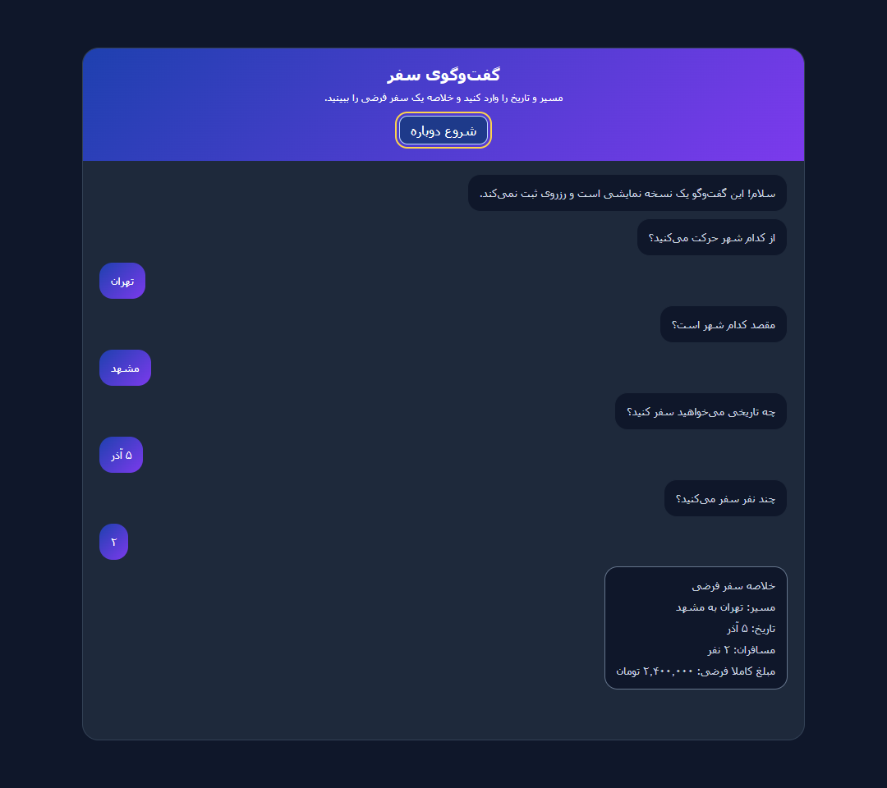
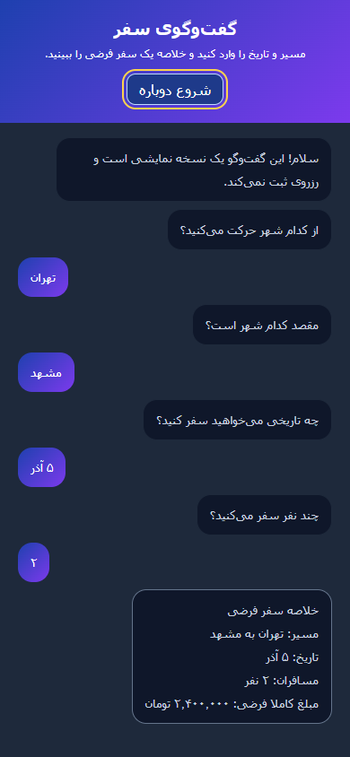

# Persian Travel Chat Demo

A standalone adaptation of a Persian travel-chat interface. The guided conversation collects an origin, destination, travel date, and passenger count, then shows a fictional trip summary. The conversation runs entirely in the browser and resets when the page is refreshed.

نسخه نمایشی فارسی برای وارد کردن مسیر، تاریخ و تعداد مسافران در قالب گفت‌وگو. نتیجه فقط یک پیش‌نمایش فرضی است و هیچ رزروی ثبت نمی‌شود.

## Screenshots



<details>
<summary>Mobile conversation</summary>



</details>

## Run locally

From the repository directory, start a local static server.

```sh
python -m http.server 8000 --bind 127.0.0.1
```

Open http://127.0.0.1:8000 in your browser. The demo has no package dependencies, backend, keys, or external services. The example fare is fixed demo data.
