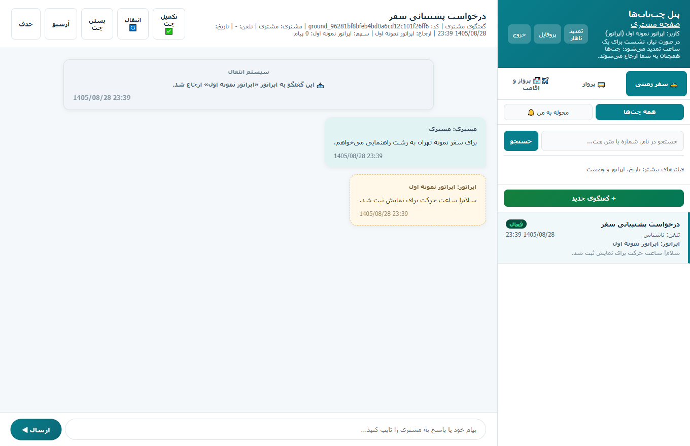
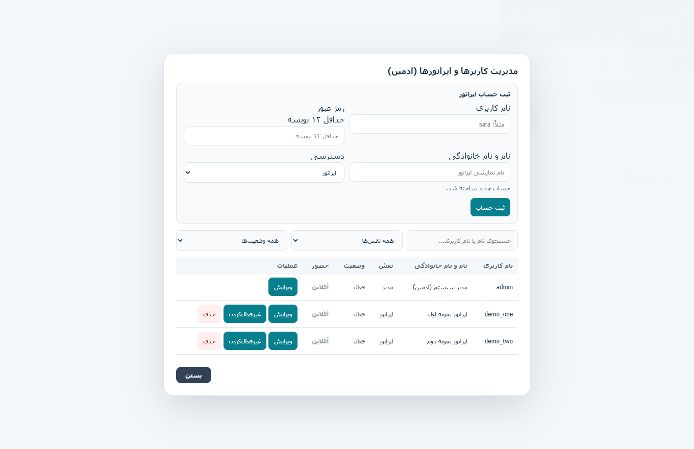

# Persian Travel Chat and Operator Console

A standalone edition adapted from the original Persian customer chat and operator dashboard. Run one local Python process to open the customer chat, manage operator accounts and handle support requests. Python's standard library and SQLite are sufficient.

## What works locally

- The customer can collect trip details, choose fictional flight and accommodation offers, or open a support conversation.
- The operator console keeps the original three-queue layout, conversation list, search and filters, and chat view. Operators can reply, transfer a conversation, complete it, close or reopen it, and archive it.
- The admin panel can create, edit and deactivate operator accounts and review conversations. Chat history persists in SQLite. The demo starts with an empty history.
- The demo uses local sample fares. The model, maps, live booking, website integrations, driver directory and competitor monitor are outside this standalone edition.

## Run

From this directory, use Python 3.10 or later.

```sh
python server.py
```

Open [customer chat](http://127.0.0.1:8000/) and the [operator console](http://127.0.0.1:8000/operator). Sign in as `admin` with the password printed in the terminal on first run. Use مدیریت اپراتورها to create an operator, then sign into that account in another browser window or private session. Send a message using گفتگو با اپراتور محلی on the customer page.

The server only listens on localhost and writes test conversations and accounts under the Git-ignored `.local-data/` directory. Use sample messages. The trip summary never creates a live reservation.

## Screenshots

### Operator console



### Account management



### Customer chat


<details>
<summary>Mobile customer chat</summary>


</details>
